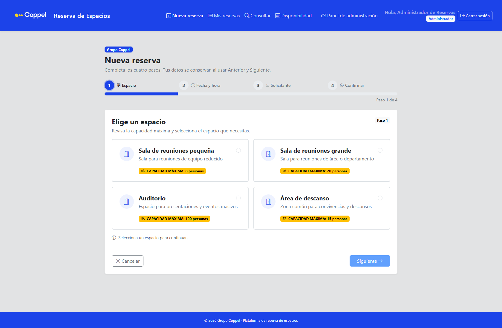
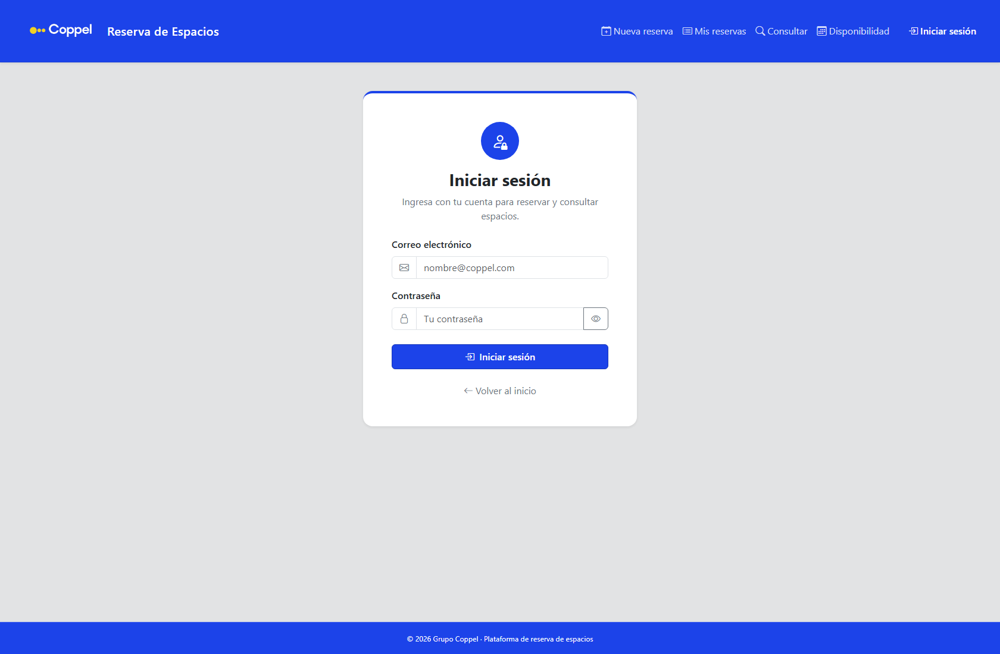
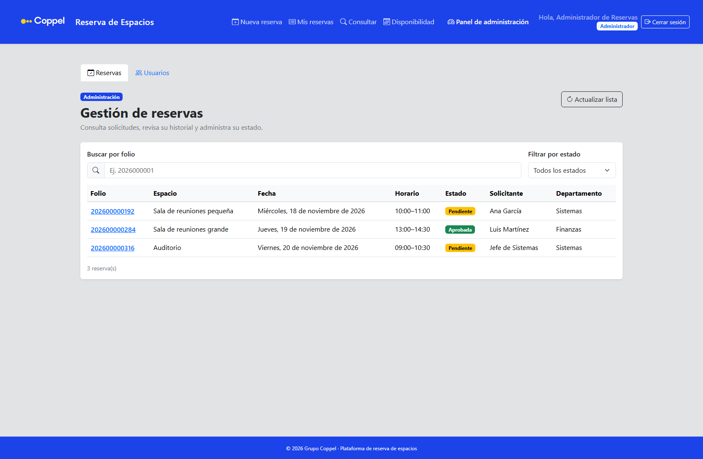
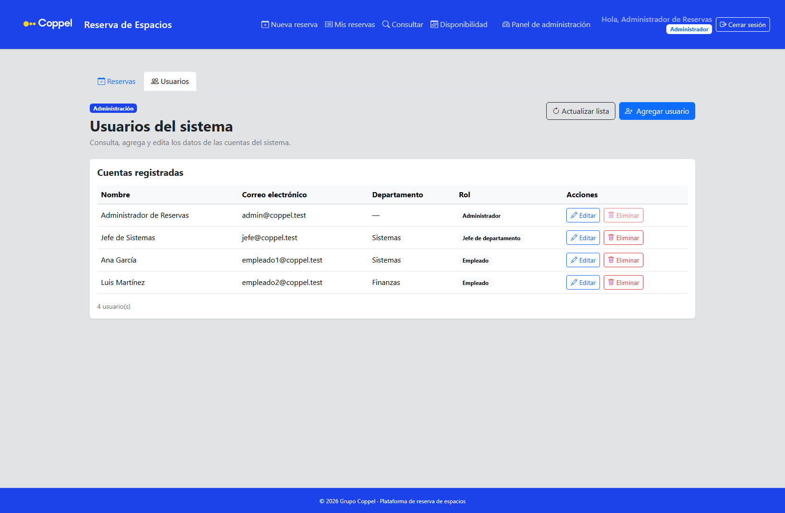

# Reservas Coppel: plataforma de reserva de espacios corporativos

Plataforma web para gestionar reservas de espacios internos (salas de reuniones, auditorio y área de descanso). Los empleados solicitan reservas y consultan su estado con un folio; los administradores revisan, aprueban, rechazan, modifican o cancelan las solicitudes.

Proyecto desarrollado como prueba técnica.

> **Estado actual:** API REST y frontend Angular implementados. Incluye reservas autenticadas por usuario, disponibilidad, administración de reservas y gestión de cuentas por ADMIN.

## Tecnologías

| Capa | Tecnología |
|---|---|
| Backend | Java 25, Spring Boot 4.1.2, Spring Data JPA (Hibernate), Spring Security |
| Base de datos | PostgreSQL 18 |
| Autenticación | JWT (HS256) y bcrypt para contraseñas |
| Frontend | Angular 20, TypeScript, Bootstrap 5 |
| Herramientas | Maven (wrapper incluido), npm, Lombok, Postman |

## Estructura del repositorio

```
Prueba-Tecnica-Coppel/
├── backend/                 API REST (Spring Boot)
│   └── src/main/java/com/coppel/reservas/
│       ├── config/          Seguridad, JWT, cifrado y datos iniciales
│       ├── controller/      Endpoints REST
│       ├── dto/             Objetos de entrada y salida de la API
│       ├── exception/       Excepciones y manejo global de errores
│       ├── model/           Entidades JPA y enums
│       ├── repository/      Acceso a datos (Spring Data JPA)
│       └── service/         Reglas de negocio
├── frontend/                Aplicación Angular standalone
│   ├── public/              Recursos estáticos (logo)
│   └── src/app/             Pantallas, rutas, servicios y lógica compartida
├── docs/capturas/            Capturas actuales de las pantallas principales
└── README.md
```

El backend sigue una arquitectura en capas (controlador, servicio, repositorio, modelo) y una API REST.

## Requisitos previos

- JDK 25 (versión configurada en Maven)
- PostgreSQL 18
- Node.js 22 y npm (Angular CLI se instala con las dependencias del frontend)
- Git

## Puesta en marcha del backend

1. **Clona el repositorio.**

2. **Crea la base de datos** en PostgreSQL:

   ```sql
   CREATE DATABASE reservas_db;
   ```

3. **Configura las variables de entorno.** Para el perfil de desarrollo, la contraseña local de PostgreSQL tiene un valor predeterminado (`123456`); puedes reemplazarla con `DB_PASSWORD`.

   En PowerShell:

   ```powershell
   $env:DB_PASSWORD = "TU_CONTRASEÑA"
   ```

4. **Ejecuta la aplicación** desde la carpeta `backend` con el perfil `dev`:

   ```bash
   ./mvnw -Dspring-boot.run.profiles=dev spring-boot:run
   ```

   En Windows (PowerShell): `.\mvnw.cmd -Dspring-boot.run.profiles=dev spring-boot:run`

5. La API queda disponible en `http://localhost:8080`.

Al arrancar por primera vez, Hibernate crea las tablas automáticamente y se cargan los datos iniciales (espacios y usuarios de prueba). Los datos no se duplican al reiniciar.

Swagger UI solo se habilita con el perfil `dev`: [http://localhost:8080/swagger-ui/index.html](http://localhost:8080/swagger-ui/index.html). Sin ese perfil, la clave `JWT_SECRET` y la contraseña `DB_PASSWORD` deben configurarse en el entorno.

## Puesta en marcha del frontend

1. Asegúrate de que el backend esté ejecutándose en `http://localhost:8080`.
2. Desde la raíz del repositorio, entra a `frontend` e instala las dependencias:

   ```bash
   cd frontend
   npm install
   ```

3. Inicia el servidor de desarrollo:

   ```bash
   npm start
   ```

   El script `npm start` ejecuta `ng serve`. También puedes iniciar Angular directamente con `npx ng serve`. `ng start` no es un comando del Angular CLI.

4. Abre `http://localhost:4200`.

El backend permite solicitudes CORS desde `http://localhost:4200`.

### Pantallas del frontend

| Ruta | Pantalla | Función |
|---|---|---|
| `/` | Inicio | Acceso a reserva, consulta y disponibilidad |
| `/reservar` | Nueva reserva | Formulario en cuatro pasos con validación de horarios |
| `/consultar` | Consulta por folio | Muestra datos, estado e historial de una reserva |
| `/consultar/{folio}` | Consulta directa | Abre la consulta con el folio indicado |
| `/calendario` | Disponibilidad | Consulta espacios y franjas ocupadas por fecha |
| `/login` | Inicio de sesión | Acceso único para empleados y administradores |
| `/admin/login` | Redirección | Redirige al inicio de sesión único |
| `/admin/reservas` | Gestión de reservas | Lista, detalle, historial y acciones administrativas |
| `/admin/usuarios` | Gestión de usuarios | Consulta, alta, edición y eliminación de cuentas; solo ADMIN |
| `/mis-reservas` | Mis reservas | Consulta las reservas creadas por la cuenta autenticada |

La ruta `/admin` redirige a `/admin/reservas`. Reservar, consultar folios y ver **Mis reservas** requieren sesión. La disponibilidad sigue siendo pública. Las rutas administrativas admiten solo `ADMIN` y `JEFE_DEPARTAMENTO`; la gestión de usuarios es exclusiva de `ADMIN`.

### Capturas de la interfaz

Las capturas muestran la interfaz actual con datos de ejemplo; no contienen datos reales.

#### Inicio


#### Nueva reserva



#### Inicio de sesión



#### Panel de administración: reservas



#### Panel de administración: usuarios



### Variables de configuración

| Variable | Para qué sirve | Valor por defecto |
|---|---|---|
| `JWT_SECRET` | Clave de firma de los tokens (mínimo 32 caracteres) | Ninguno fuera de `dev`; clave local en `dev` |
| `DB_PASSWORD` | Contraseña de PostgreSQL | Ninguno fuera de `dev`; `123456` en `dev` |

`JWT_SECRET` es obligatoria fuera del perfil `dev`. La aplicación no inicia si tiene menos de 32 caracteres.

## Datos de prueba

**Espacios**

| Id | Espacio | Capacidad |
|---|---|---|
| 1 | Sala de reuniones pequeña | 8 |
| 2 | Sala de reuniones grande | 20 |
| 3 | Auditorio | 100 |
| 4 | Área de descanso | 15 |

Las capacidades son datos de ejemplo, ya que el documento de requerimientos no las define.

**Cuentas de prueba**

| Correo | Contraseña | Rol |
|---|---|---|
| admin@coppel.test | Admin123! | ADMIN |
| jefe@coppel.test | Jefe123! | JEFE_DEPARTAMENTO |
| empleado1@coppel.test | Empleado123! | EMPLEADO (Sistemas) |
| empleado2@coppel.test | Empleado123! | EMPLEADO (Finanzas) |

Las contraseñas se almacenan cifradas con bcrypt.
Las cuentas faltantes se siembran al iniciar el backend, sin sobrescribir cuentas existentes. No existe registro público: solo `ADMIN` puede consultar, crear, editar o eliminar cuentas desde la pestaña **Usuarios**. No se puede eliminar la cuenta con la que se inició sesión; las reservas y el historial de una cuenta eliminada se conservan desvinculados del usuario.

### Roles y permisos

| Rol | Permisos |
|---|---|
| `EMPLEADO` | Iniciar sesión, reservar espacios y consultar/listar únicamente sus propias reservas. |
| `JEFE_DEPARTAMENTO` | Consultar cualquier reserva y listar, aprobar, rechazar o modificar reservas; no puede cancelar ni administrar usuarios. |
| `ADMIN` | Todas las operaciones de reservas, incluida la cancelación, y consultar, crear, editar o eliminar cuentas de usuario. |

## API REST

### Implementados

| Método | Ruta | Acceso | Descripción |
|---|---|---|---|
| POST | `/api/reservas` | Cualquier usuario autenticado | Crea una solicitud a nombre del usuario |
| GET | `/api/reservas/{folio}` | Autenticado; empleados solo ven las propias | Consulta una reserva y su historial |
| GET | `/api/reservas/mias` | Cualquier usuario autenticado | Lista las reservas del usuario actual |
| POST | `/api/auth/login` | Público | Inicia sesión y devuelve un JWT |
| GET | `/api/espacios` | Público | Lista los espacios y su capacidad |
| GET | `/api/espacios/{id}/disponibilidad?fecha=YYYY-MM-DD` | Público | Horarios ocupados de un espacio en una fecha |
| GET | `/api/admin/reservas?estado=PENDIENTE` | ADMIN, JEFE_DEPARTAMENTO | Lista reservas; el filtro `estado` es opcional |
| GET | `/api/admin/reservas/{folio}` | ADMIN, JEFE_DEPARTAMENTO | Consulta detalle e historial de una reserva |
| PUT | `/api/admin/reservas/{folio}/estado` | ADMIN, JEFE_DEPARTAMENTO | Aprueba o rechaza una reserva pendiente |
| PUT | `/api/admin/reservas/{folio}` | ADMIN, JEFE_DEPARTAMENTO | Modifica espacio, fecha y horario |
| DELETE | `/api/admin/reservas/{folio}` | Solo ADMIN | Cancela una reserva |
| GET | `/api/admin/usuarios` | Solo ADMIN | Lista usuarios sin exponer contraseñas ni hashes |
| POST | `/api/admin/usuarios` | Solo ADMIN | Crea una cuenta y guarda su contraseña cifrada |
| PUT | `/api/admin/usuarios/{id}` | Solo ADMIN | Edita nombre, correo, departamento y rol; no cambia la contraseña |
| DELETE | `/api/admin/usuarios/{id}` | Solo ADMIN | Elimina la cuenta; conserva las reservas e historial |

Las rutas `/api/admin/**` requieren `Authorization: Bearer <token>` y rol `ADMIN` o `JEFE_DEPARTAMENTO`. `/api/admin/usuarios/**` exige además rol `ADMIN`.

### Ejemplo: crear una reserva

`POST /api/reservas`

```json
{
  "espacioId": 1,
  "fecha": "2026-11-20",
  "horaInicio": "10:00",
  "horaFin": "11:00",
  "descripcion": "Reunión de planeación"
}
```

El nombre y departamento del solicitante se toman del perfil autenticado; los campos antiguos `solicitante` y `departamento` se siguen aceptando por compatibilidad, pero se ignoran. Respuesta **201 Created** (resumida):

```json
{
  "folio": "202600000192",
  "espacio": "Sala de reuniones pequeña",
  "estado": "PENDIENTE",
  "duracionMinutos": 60,
  "historial": [
    { "accion": "CREADA", "usuario": "Solicitante" }
  ]
}
```

### Ejemplo: iniciar sesión

`POST /api/auth/login`

```json
{ "email": "admin@coppel.test", "password": "Admin123!" }
```

Devuelve el `token`, su tipo (`Bearer`), la fecha de expiración y el rol del usuario.

### Formato de errores

Todos los errores usan el mismo formato y el código HTTP correspondiente:

```json
{
  "status": 409,
  "error": "Conflict",
  "mensaje": "El espacio ya está reservado en ese horario. Elige otro horario u otro espacio.",
  "detalles": [],
  "fecha": "2026-11-14T01:13:52.046"
}
```

| Código | Cuándo ocurre |
|---|---|
| 400 | Datos inválidos, formato de fecha u hora incorrecto, o regla de negocio incumplida |
| 401 | Credenciales incorrectas o token ausente o inválido |
| 403 | El usuario no tiene permisos para la operación |
| 404 | No existe el folio o el espacio; también se rechaza un dígito de verificación inválido |
| 409 | Horario ocupado o estado que no permite la operación |
| 429 | Se excedió el límite de solicitudes por IP |

## Reglas de negocio

- Toda reserva nace en estado **PENDIENTE**.
- Los folios nuevos son numéricos: año + id con seis dígitos + verificación de dos dígitos (por ejemplo `202600000192`). Los folios históricos de diez dígitos se siguen aceptando.
- **No se permiten solapamientos**: no puede haber dos reservas en el mismo espacio, fecha y horario traslapado. Una reserva que empieza justo cuando termina otra sí es válida.
- Solo las reservas **pendientes y aprobadas** bloquean el espacio; las rechazadas y canceladas lo liberan.
- Horario permitido: de **08:00 a 20:00**, con duración mínima de **30 minutos**.
- No se puede reservar en una fecha y hora que ya pasó.
- Cada cambio queda registrado en el **historial** con la fecha y el usuario que lo realizó.

## Seguridad

- Autenticación con **JWT** firmado (HS256) y vigencia de 2 horas.
- Clave JWT obligatoria fuera del perfil `dev`, con mínimo de 32 caracteres.
- Contraseñas cifradas con **bcrypt**.
- El inicio de sesión es único para todos los roles. Reservar y consultar requieren autenticación; un empleado solo puede ver sus reservas. `ADMIN` y `JEFE_DEPARTAMENTO` pueden consultar cualquier folio y gestionar reservas.
- No hay registro público. El acceso a `/api/admin/usuarios` está restringido a `ADMIN`.
- CORS limitado a los orígenes configurados en `app.cors.allowed-origins` y a los encabezados `Authorization`, `Content-Type` y `Accept`.
- Rate limit en memoria por IP: 5 intentos por minuto para el login, 10 para crear reservas y 120 para el resto de la API. Se puede desactivar en pruebas con `app.ratelimit.enabled=false`.
- Swagger y Actuator están desactivados por defecto; Swagger y el health check de Actuator se habilitan solo con `dev`. Las rutas de Actuator requieren autenticación.

## Decisiones y supuestos

- Las cuentas se crean o editan únicamente desde el panel de usuarios con una sesión `ADMIN`.
- La pantalla `/admin/login` se conserva como redirección compatible hacia `/login`.
- La duración de una reserva no se guarda: se calcula a partir de la hora de inicio y fin para evitar datos contradictorios.
- Las reservas **canceladas** no se borran: se conservan con su historial.
- Las capacidades, el horario de atención y la duración mínima son supuestos propios y se ajustan fácilmente en el código.

## Pruebas

Ejecuta cada comando desde la carpeta indicada. El backend usa el perfil `test` durante las pruebas y desactiva el rate limit; la base de datos PostgreSQL debe estar disponible.

**Backend** (desde `backend`):

```powershell
.\mvnw.cmd test
```

**Frontend: compilación y pruebas unitarias** (desde `frontend`):

```bash
npm run build
npm test -- --watch=false
```

Las pruebas unitarias usan Chrome Headless. Si Chrome no está en la ruta predeterminada, define `CHROME_BIN` con la ruta de Chrome o Edge antes de ejecutar `npm test`.

**Pruebas E2E** (desde `frontend`):

```bash
npx playwright install chromium
npm run test:e2e
```

Las E2E recorren el formulario de reserva y la gestión de usuarios (alta, edición y eliminación), validan la navegación de sesión y los permisos por rol. Simulan la API, por lo que no requieren el backend ni la base de datos.

## Pendiente antes de producción

- Publicar únicamente detrás de **HTTPS**.
- Añadir bloqueo progresivo o temporal de cuentas tras intentos fallidos de inicio de sesión.
- Definir un proceso de **rotación de claves JWT** y mantener las claves fuera del repositorio.
- Revisar el almacenamiento del token en el frontend y evaluar opciones más seguras que `localStorage` según la arquitectura de despliegue.
- Sustituir las credenciales de prueba y no habilitar el perfil `dev` en producción.