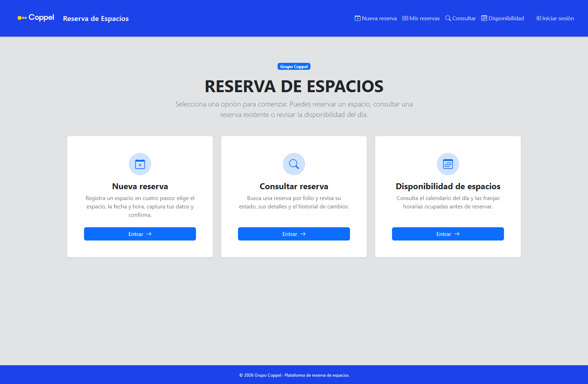
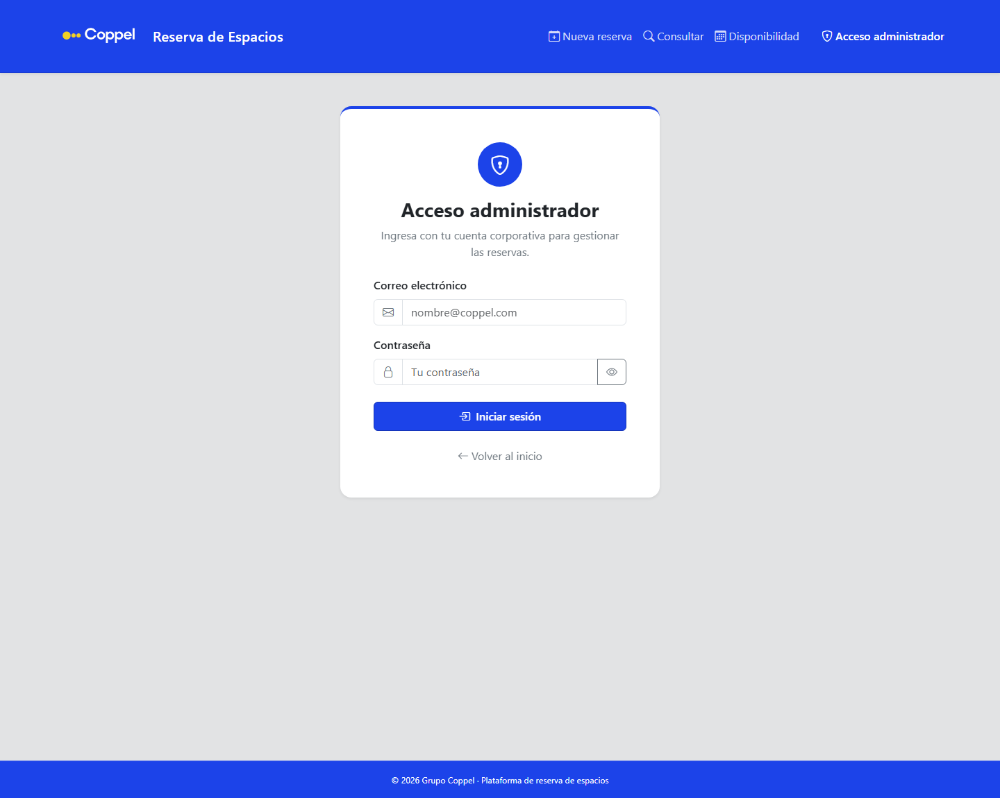

# Reservas Coppel: plataforma de reserva de espacios corporativos

Plataforma web para gestionar reservas de espacios internos (salas de reuniones, auditorio y área de descanso). Los empleados solicitan reservas y consultan su estado con un folio; los administradores revisan, aprueban, rechazan, modifican o cancelan las solicitudes.

Proyecto desarrollado como prueba técnica.

> **Estado actual:** API REST y frontend Angular implementados. El backend incluye el portal del empleado, disponibilidad, autenticación JWT y administración de reservas.

## Tecnologías

| Capa | Tecnología |
|---|---|
| Backend | Java 25, Spring Boot 4.1.2, Spring Data JPA (Hibernate), Spring Security |
| Base de datos | PostgreSQL 18 |
| Autenticación | JWT (HS256) y bcrypt para contraseñas |
| Frontend | Angular 20, TypeScript, Bootstrap 5 |
| Herramientas | Maven (wrapper incluido), npm, Lombok, Postman |

## Estructura del repositorio

```
Prueba-Tecnica-Coppel/
├── backend/                 API REST (Spring Boot)
│   └── src/main/java/com/coppel/reservas/
│       ├── config/          Seguridad, JWT, cifrado y datos iniciales
│       ├── controller/      Endpoints REST
│       ├── dto/             Objetos de entrada y salida de la API
│       ├── exception/       Excepciones y manejo global de errores
│       ├── model/           Entidades JPA y enums
│       ├── repository/      Acceso a datos (Spring Data JPA)
│       └── service/         Reglas de negocio
├── frontend/                Aplicación Angular standalone
│   ├── public/              Recursos estáticos (logo)
│   └── src/app/             Pantallas, rutas, servicios y lógica compartida
├── GUIA_FRONTEND.md         Guía para presentar la arquitectura Angular
└── README.md
```

El backend sigue una arquitectura en capas (controlador, servicio, repositorio, modelo) y una API REST.

## Requisitos previos

- JDK 25 (o 21 como mínimo)
- PostgreSQL 18
- Node.js 22 y npm (Angular CLI se instala con las dependencias del frontend)
- Git

## Puesta en marcha del backend

1. **Clona el repositorio.**

2. **Crea la base de datos** en PostgreSQL:

   ```sql
   CREATE DATABASE reservas_db;
   ```

3. **Configura la conexión** en `backend/src/main/resources/application.properties`:

   ```properties
   spring.datasource.url=jdbc:postgresql://localhost:5432/reservas_db
   spring.datasource.username=postgres
   spring.datasource.password=TU_CONTRASEÑA
   ```

4. **Ejecuta la aplicación** desde la carpeta `backend`:

   ```bash
   ./mvnw spring-boot:run
   ```

   En Windows (PowerShell): `.\mvnw spring-boot:run`

5. La API queda disponible en `http://localhost:8080`.

Al arrancar por primera vez, Hibernate crea las tablas automáticamente y se cargan los datos iniciales (espacios y usuarios de prueba). Los datos no se duplican al reiniciar.

La documentación interactiva de la API está disponible en [Swagger UI](http://localhost:8080/swagger-ui/index.html).

## Puesta en marcha del frontend

1. Asegúrate de que el backend esté ejecutándose en `http://localhost:8080`.
2. Desde la raíz del repositorio, entra a `frontend` e instala las dependencias:

   ```bash
   cd frontend
   npm install
   ```

3. Inicia el servidor de desarrollo:

   ```bash
   npm start
   ```

   El script `npm start` ejecuta `ng serve`. También puedes iniciar Angular directamente con `npx ng serve`. `ng start` no es un comando del Angular CLI.

4. Abre `http://localhost:4200`.

El backend permite solicitudes CORS desde `http://localhost:4200`.

### Pantallas del frontend

| Ruta | Pantalla | Función |
|---|---|---|
| `/` | Inicio | Acceso a reserva, consulta y disponibilidad |
| `/reservar` | Nueva reserva | Formulario en cuatro pasos con validación de horarios |
| `/consultar` | Consulta por folio | Muestra datos, estado e historial de una reserva |
| `/consultar/{folio}` | Consulta directa | Abre la consulta con el folio indicado |
| `/calendario` | Disponibilidad | Consulta espacios y franjas ocupadas por fecha |
| `/admin/login` | Acceso administrador | Inicio de sesión para usuarios administrativos |
| `/admin/reservas` | Gestión de reservas | Lista, detalle, historial y acciones administrativas |

La ruta `/admin` redirige a `/admin/reservas`. Las rutas de administración están protegidas por sesión.

### Capturas de la interfaz

#### Inicio



#### Nueva reserva


#### Acceso administrador



### Variables opcionales

| Variable | Para qué sirve | Valor por defecto |
|---|---|---|
| `JWT_SECRET` | Clave de firma de los tokens (mínimo 32 caracteres) | Clave de desarrollo |

## Datos de prueba

**Espacios**

| Id | Espacio | Capacidad |
|---|---|---|
| 1 | Sala de reuniones pequeña | 8 |
| 2 | Sala de reuniones grande | 20 |
| 3 | Auditorio | 100 |
| 4 | Área de descanso | 15 |

Las capacidades son datos de ejemplo, ya que el documento de requerimientos no las define.

**Usuarios del portal de administración**

| Correo | Contraseña | Rol |
|---|---|---|
| admin@coppel.test | Admin123! | ADMIN |
| jefe@coppel.test | Jefe123! | JEFE_DEPARTAMENTO |

Las contraseñas se almacenan cifradas con bcrypt.

## API REST

### Implementados

| Método | Ruta | Acceso | Descripción |
|---|---|---|---|
| POST | `/api/reservas` | Público | Crea una solicitud de reserva y devuelve su folio |
| GET | `/api/reservas/{folio}` | Público | Consulta una reserva y su historial de cambios |
| POST | `/api/auth/login` | Público | Inicia sesión y devuelve un JWT |
| GET | `/api/espacios` | Público | Lista los espacios y su capacidad |
| GET | `/api/espacios/{id}/disponibilidad?fecha=YYYY-MM-DD` | Público | Horarios ocupados de un espacio en una fecha |
| GET | `/api/admin/reservas?estado=PENDIENTE` | ADMIN, JEFE_DEPARTAMENTO | Lista reservas; el filtro `estado` es opcional |
| GET | `/api/admin/reservas/{folio}` | ADMIN, JEFE_DEPARTAMENTO | Consulta detalle e historial de una reserva |
| PUT | `/api/admin/reservas/{folio}/estado` | ADMIN, JEFE_DEPARTAMENTO | Aprueba o rechaza una reserva pendiente |
| PUT | `/api/admin/reservas/{folio}` | ADMIN, JEFE_DEPARTAMENTO | Modifica espacio, fecha y horario |
| DELETE | `/api/admin/reservas/{folio}` | Solo ADMIN | Cancela una reserva |

Todas las rutas `/api/admin/**` requieren el encabezado `Authorization: Bearer <token>`.

### Ejemplo: crear una reserva

`POST /api/reservas`

```json
{
  "espacioId": 1,
  "fecha": "2026-11-20",
  "horaInicio": "10:00",
  "horaFin": "11:00",
  "solicitante": "Nombre Apellido",
  "departamento": "Sistemas",
  "descripcion": "Reunión de planeación"
}
```

Respuesta **201 Created** (resumida):

```json
{
  "folio": "2026000001",
  "espacio": "Sala de reuniones pequeña",
  "estado": "PENDIENTE",
  "duracionMinutos": 60,
  "historial": [
    { "accion": "CREADA", "usuario": "Solicitante" }
  ]
}
```

### Ejemplo: iniciar sesión

`POST /api/auth/login`

```json
{ "email": "admin@coppel.test", "password": "Admin123!" }
```

Devuelve el `token`, su tipo (`Bearer`), la fecha de expiración y el rol del usuario.

### Formato de errores

Todos los errores usan el mismo formato y el código HTTP correspondiente:

```json
{
  "status": 409,
  "error": "Conflict",
  "mensaje": "El espacio ya está reservado en ese horario. Elige otro horario u otro espacio.",
  "detalles": [],
  "fecha": "2026-11-14T01:13:52.046"
}
```

| Código | Cuándo ocurre |
|---|---|
| 400 | Datos inválidos, formato de fecha u hora incorrecto, o regla de negocio incumplida |
| 401 | Credenciales incorrectas o token ausente o inválido |
| 403 | El usuario no tiene permisos para la operación |
| 404 | No existe el folio o el espacio |
| 409 | El espacio ya está reservado en ese horario |

## Reglas de negocio

- Toda reserva nace en estado **PENDIENTE**.
- El folio es numérico e irrepetible: año de la reserva más el id con seis dígitos (por ejemplo `2026000123`).
- **No se permiten solapamientos**: no puede haber dos reservas en el mismo espacio, fecha y horario traslapado. Una reserva que empieza justo cuando termina otra sí es válida.
- Solo las reservas **pendientes y aprobadas** bloquean el espacio; las rechazadas y canceladas lo liberan.
- Horario permitido: de **08:00 a 20:00**, con duración mínima de **30 minutos**.
- No se puede reservar en una fecha y hora que ya pasó.
- Cada cambio queda registrado en el **historial** con la fecha y el usuario que lo realizó (sin usuario cuando lo origina el solicitante).

## Seguridad

- Autenticación con **JWT** firmado (HS256) y vigencia de 2 horas.
- Contraseñas cifradas con **bcrypt**.
- Rutas del empleado públicas; rutas de administración restringidas a los roles `ADMIN` y `JEFE_DEPARTAMENTO`.
- CORS habilitado para el frontend en `http://localhost:4200`.

## Decisiones y supuestos

- Los empleados no tienen cuenta: se identifican en la solicitud con su nombre y departamento. Solo el personal administrativo inicia sesión.
- La duración de una reserva no se guarda: se calcula a partir de la hora de inicio y fin para evitar datos contradictorios.
- Las reservas **canceladas** no se borran: se conservan con su historial.
- Las capacidades, el horario de atención y la duración mínima son supuestos propios y se ajustan fácilmente en el código.

## Pruebas manuales realizadas

Se probaron con Postman los siguientes casos del portal del empleado y del login:

- Creación de reservas válidas en distintos espacios.
- Rechazo por horarios solapados (409), con los casos límite incluidos.
- Validaciones de campos obligatorios, formato de fecha y hora, fecha pasada, horario fuera de rango (400).
- Espacio inexistente (404) y folio inexistente (404).
- Login correcto, credenciales incorrectas y datos inválidos.
- Acceso a rutas de administración sin token, con token válido y con token alterado.

El frontend cuenta con pruebas unitarias para servicios HTTP, autenticación, guardas y reglas de reserva.

## Consideraciones para producción

- Configura `DB_PASSWORD` y `JWT_SECRET` con valores seguros en el entorno de despliegue; los valores predeterminados son solo para desarrollo.
- Sustituye las credenciales de prueba antes de publicar la aplicación.